# Adversarial Machine Learning Against Network Intrusion Detection Systems (IDS)

**A Cybersecurity Class Project**

This project investigates machine-learning-based Network Intrusion
Detection Systems (NIDS) using the CICIDS2017 dataset. It evaluates five
machine learning algorithms under clean and controlled adversarial
feature-perturbation conditions and presents the findings through an
interactive Streamlit dashboard.

------------------------------------------------------------------------

## Overview

The project studies whether controlled adversarial feature perturbations
affect intrusion detection performance and whether adversarial training
can improve model robustness.

## Objectives

-   Build machine-learning-based network intrusion detection models.
-   Compare five classification algorithms on clean test data.
-   Evaluate the effect of controlled adversarial feature perturbations.
-   Explore adversarial training using a Robust Random Forest.
-   Present model comparisons and experimental findings in a Streamlit
    dashboard.

## Machine Learning Algorithms

1.  Baseline Random Forest
2.  Robust Random Forest (adversarial augmentation)
3.  XGBoost
4.  Linear Support Vector Machine (SVM)
5.  Multi-Layer Perceptron (MLP)

## Dataset

**Dataset:** CICIDS2017

The project uses a balanced dataset containing 500,000 rows and 78
features, with a grouped train/test split.

The original dataset is not included in this repository. Obtain
CICIDS2017 separately and follow its applicable usage and licensing
conditions.

## Methodology

1.  **Data processing:** Prepare the dataset for binary classification
    of BENIGN and ATTACK traffic.
2.  **Clean evaluation:** Train or load the models and compare their
    performance on held-out test data.
3.  **Adversarial perturbation:** Apply controlled synthetic
    perturbations to 42 continuous features using training-derived IQR
    scaling.
4.  **Robustness validation:** Evaluate perturbation strengths of 1%,
    3%, 5%, and 10% across five random seeds.
5.  **Adversarial training:** Train a Robust Random Forest using
    adversarial augmentation and compare it with the conventional
    baseline.

**Scope limitation:** These are synthetic feature-space perturbation
experiments. They are not packet-level attacks and do not establish
resistance to real-world network evasion.

## Experimental Results

### Clean Test Accuracy

  Algorithm                  Accuracy
  ------------------------ ----------
  Baseline Random Forest      99.871%
  Robust Random Forest        99.884%
  XGBoost                     99.928%
  Linear SVM                  95.134%
  MLP                         98.739%

**Key finding:** XGBoost achieved the highest clean-test accuracy among
the evaluated models.

### Adversarial Robustness

The Robust Random Forest maintained approximately 99.99% attack
detection across the four tested synthetic perturbation strengths.

These results apply only to the experimental setup and perturbations
used in this project; they should not be interpreted as universal
immunity against adversarial attacks.

## Interactive Dashboard

The Streamlit dashboard includes:

-   Executive Overview
-   Algorithm Comparison
-   Baseline IDS
-   Robustness Comparison
-   Adversarial Stress Test
-   Methodology

### Dashboard Screenshots

#### Executive Overview

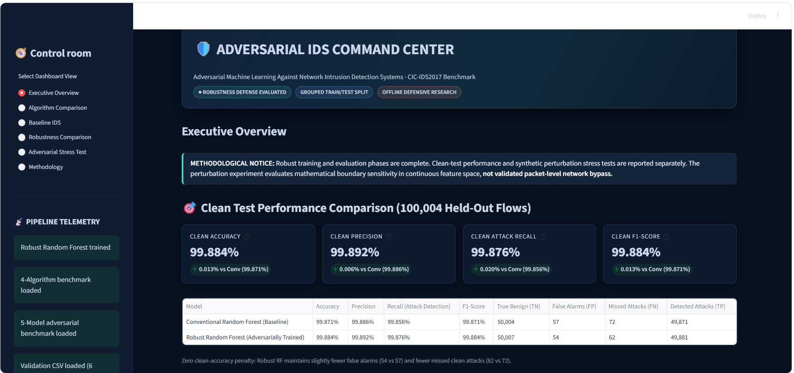

#### Algorithm Comparison

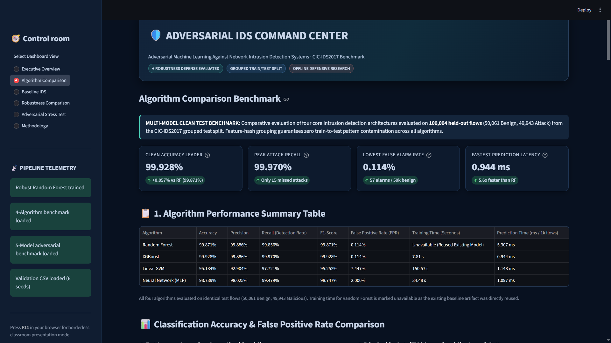

#### Baseline IDS

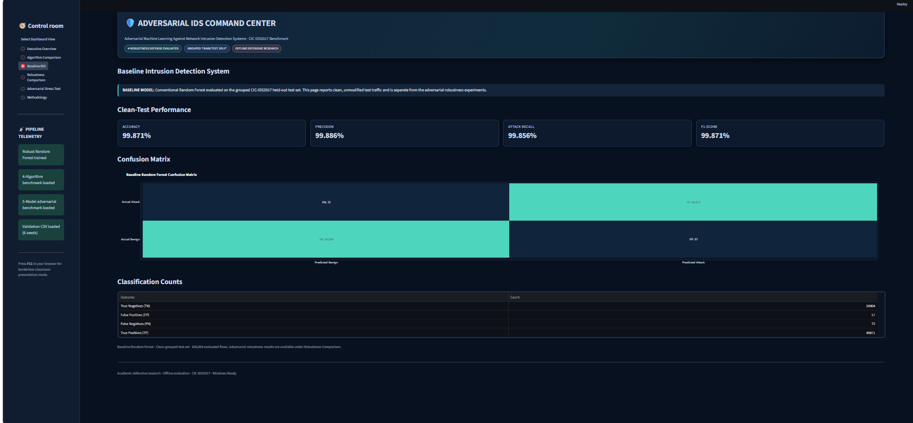

#### Classification Metrics


#### Computational Overhead

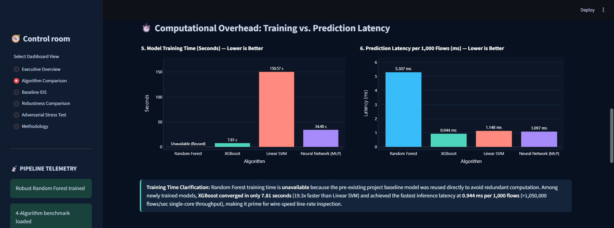

#### Confusion Matrices

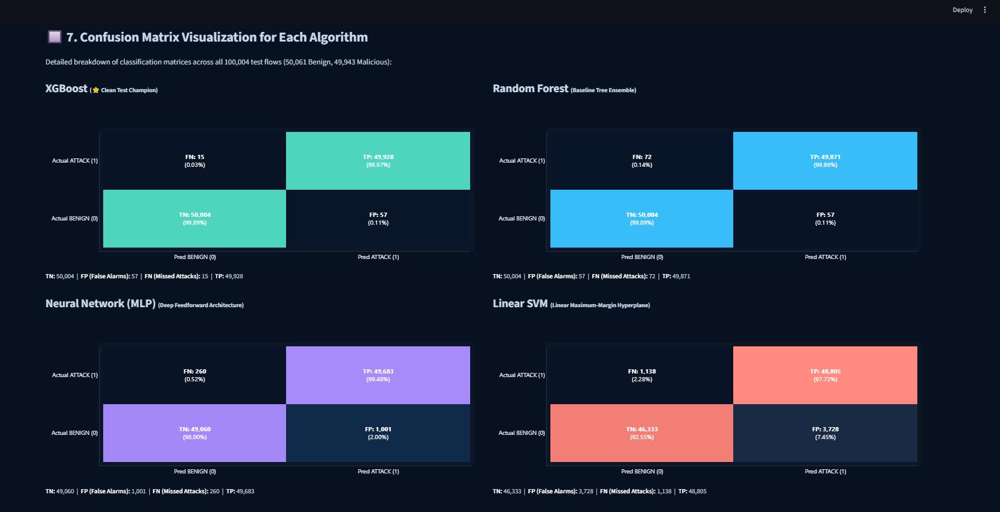

#### Robustness Comparison

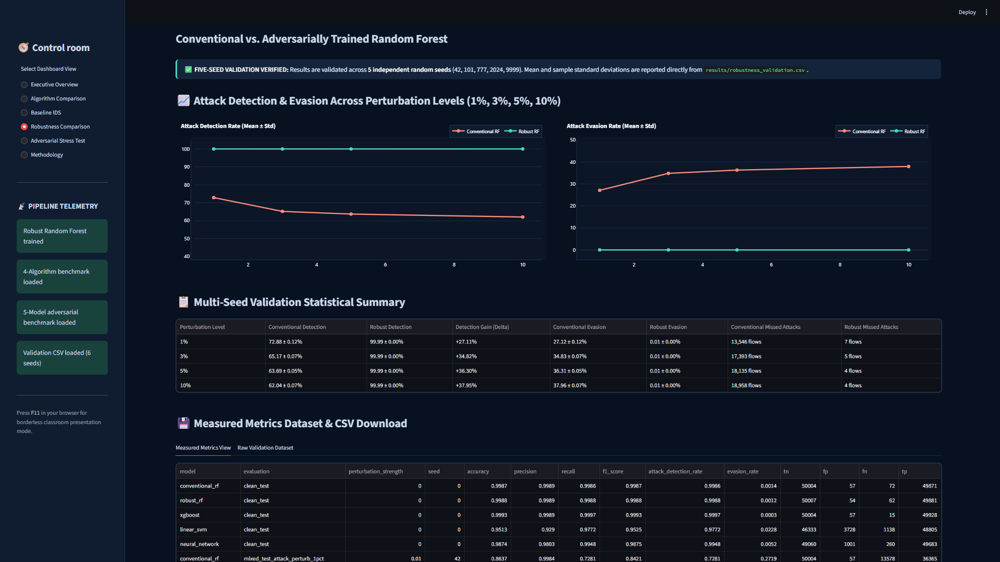

#### Five-Model Robustness Evaluation

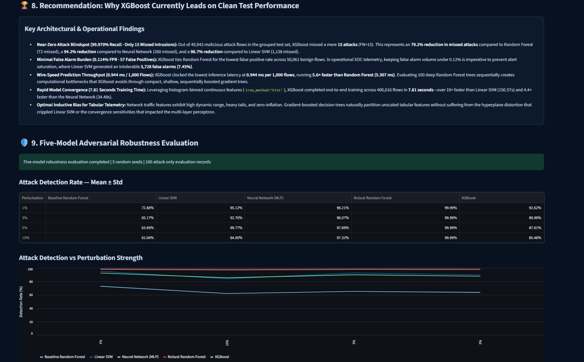

#### Multi-Seed Validation

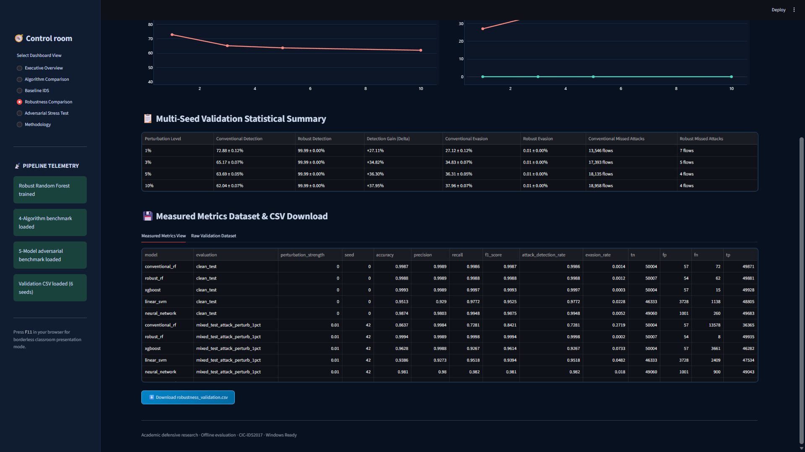

#### Statistical Report

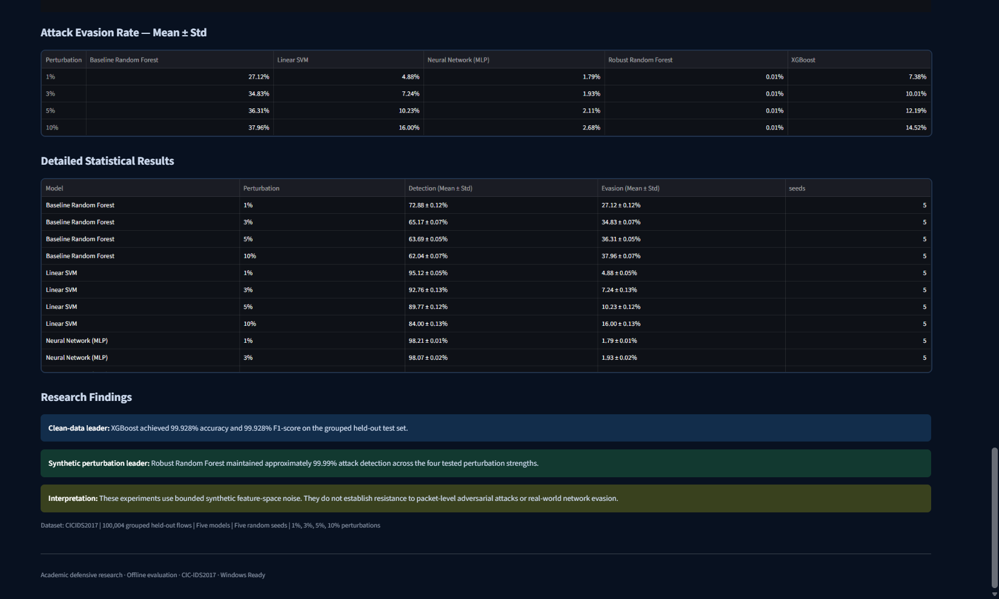

#### Adversarial Stress Test

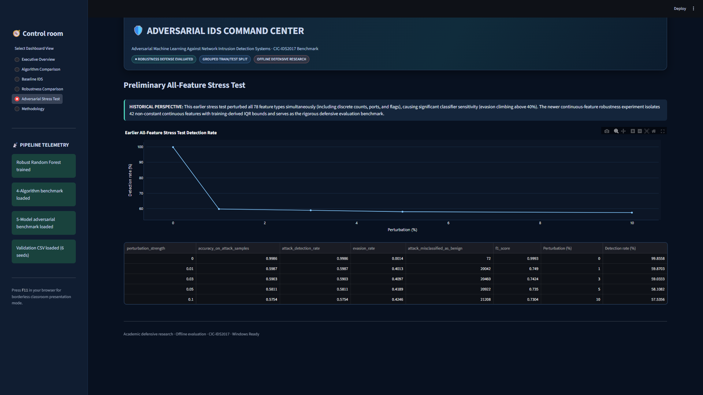

#### Synthetic Attack Detection


#### Methodology

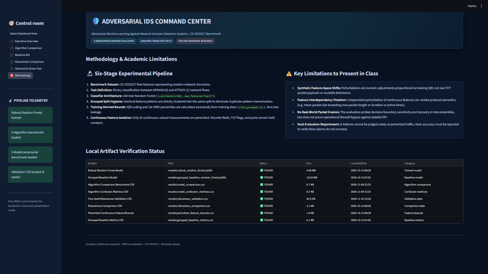

## Project Structure

``` text
adversarial-ids/
├── dashboard.py
├── requirements.txt
├── README.md
├── LICENSE
├── screenshots/
├── reports/
├── results/
├── src/
├── data/       # Dataset files are not included
└── models/     # Trained model files are not included
```

## Installation and Setup

### Prerequisites

-   Python 3.x
-   Git
-   pip

### 1. Clone the repository

``` bash
git clone https://github.com/Surya260403/adversarial-ids.git
cd adversarial-ids
```

### 2. Create and activate a virtual environment

Windows PowerShell:

``` powershell
python -m venv .venv
.venv\Scripts\Activate.ps1
```

### 3. Install dependencies

``` bash
pip install -r requirements.txt
```

If the dashboard environment does not already include these packages,
install them:

``` bash
pip install streamlit plotly xgboost
```

### 4. Run the dashboard

``` bash
streamlit run dashboard.py
```

The dashboard will open in your browser.

**Note:** The CICIDS2017 dataset and trained model files are excluded
from this public repository. Some dashboard pages or model functions may
require those local files to be supplied separately.

## Technologies Used

-   Python
-   NumPy
-   Pandas
-   Scikit-learn
-   XGBoost
-   Streamlit
-   Plotly
-   Matplotlib
-   Seaborn
-   Joblib

## Safety and Ethical Considerations

All experiments are dataset-based and controlled. This project does not
perform attacks against real systems, networks, or third-party
infrastructure.

## Project Report

The project report is available at
[`reports/Final_Project_Report.md`](reports/Final_Project_Report.md).

## Contributors

**Group G --- Cybersecurity Class Project**

-   Aryan Chand
-   Pratyush Ranjan Behera
-   Rajeswari Sahoo
-   Surya Narayan Mohanta
-   Muskan Devi
-   Subasish Saha

## License

See the [`LICENSE`](LICENSE) file for licensing information.
